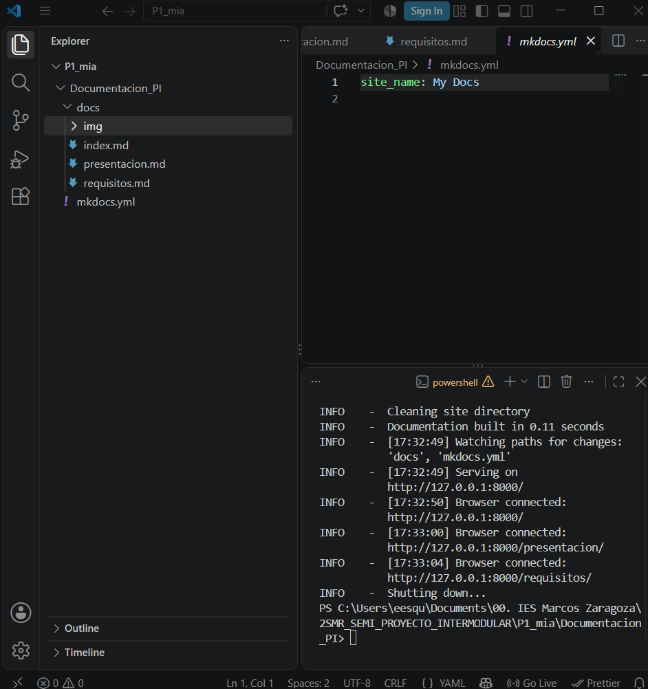

# Requisitos

## Hardware

- Ordenador compatible.
- Al menos 2 GB de memoria RAM.
- Espacio libre suficiente en el disco.

## Software

- Windows 10 o Windows 11.
- VisualStudio Code

- Conexión a Internet.
